<!-- ============================================================
  Animated Glassmorphism GitHub Profile README
  Put this README.md AND the /assets folder in your profile repo
  (repo name = your GitHub username). Replace YOUR_* placeholders.
  Edit text inside the .svg files (open in any text editor) to
  change names, project text, achievements, etc.
============================================================ -->

  

  
  
  

<!-- ================= ABOUT ================= -->

<table width="100%">
  <tr>
    <td width="62%" valign="top"></td>
    <td width="38%" valign="top"></td>
  </tr>
</table>

  I'm a <b>B.Tech IT student</b> who loves turning ideas into working software. 
  💡 Idea → 📚 Learn → 💻 Build → 🧪 Test → 🚀 Ship

<!-- ================= NOW ================= -->

<table width="100%">
  <tr>
    <td width="60%" valign="top"></td>
    <td width="40%" valign="top"></td>
  </tr>
</table>

<!-- ================= STACK ================= -->


  

<!-- ================= PROJECTS ================= -->

<table width="100%">
  <tr>
    <td width="50%"><a href="https://github.com/YOUR_USERNAME/project-one"></a></td>
    <td width="50%"><a href="https://github.com/YOUR_USERNAME/project-two"></a></td>
  </tr>
</table>

<!-- ================= STATS ================= -->

  
  

  

  

<!-- ================= ACHIEVEMENTS ================= -->


<!-- ================= CONNECT ================= -->

<table width="100%">
  <tr>
    <td width="40%" valign="middle"></td>
    <td width="60%" valign="middle" align="center">
      <a href="https://linkedin.com/in/YOUR_LINKEDIN"></a> 
      <a href="mailto:YOUR_EMAIL"></a> 
      <a href="https://YOUR_PORTFOLIO.com"></a>
        
      <i>💬 Ask me about web development, backend basics, or getting started with DSA.</i>
    </td>
  </tr>
</table>

